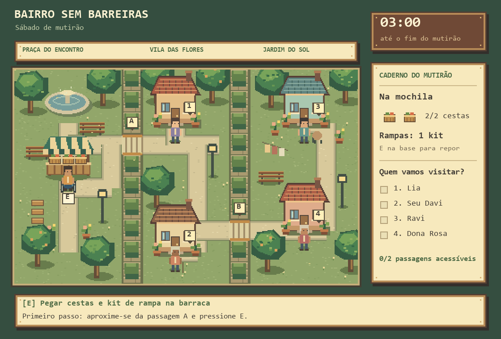
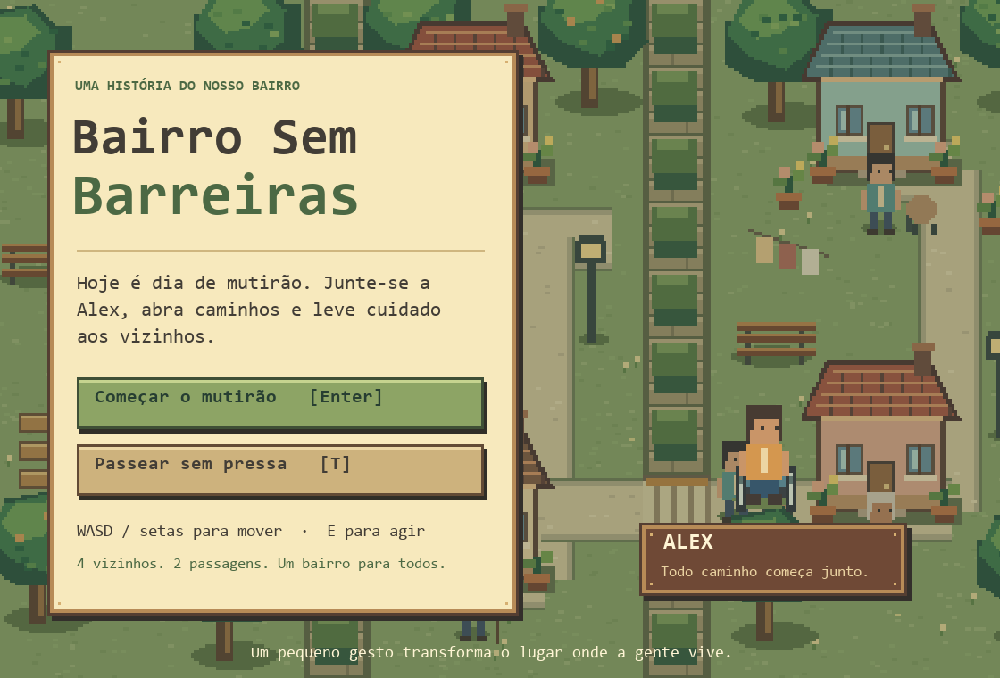

# Bairro Sem Barreiras

Um jogo sobre acessibilidade e vida em comunidade, feito em Python com PyGame.

É sábado de mutirão. Alex precisa levar cestas aos vizinhos, mas os caminhos do bairro têm barreiras. Para chegar a todos, é preciso instalar rampas, organizar a mochila e voltar à barraca para buscar suprimentos.



## Jogar

No Windows, abra **JOGAR.bat**. É necessário ter Python 3.12 instalado; marque **Add Python to PATH** durante a instalação. O iniciador instala o PyGame na primeira execução. Depois disso, o jogo funciona offline.

Para instalar e executar pelo terminal:

```powershell
py -3 -m venv .venv
.\.venv\Scripts\python.exe -m pip install -r requirements.txt
.\.venv\Scripts\python.exe main.py
```

No computador em que o projeto foi preparado, o iniciador também reconhece o ambiente `../.venv`. Não é preciso reinstalar.

## Controles

| Tecla | Ação |
|---|---|
| Enter | Iniciar um mutirão de 3 minutos |
| T no menu | Passear sem limite de tempo |
| WASD ou setas | Mover Alex |
| E ou espaço | Instalar rampa, entregar cesta ou reabastecer |
| P ou Esc | Pausar e continuar |
| M | Ligar ou desligar o som |
| R no resultado | Jogar novamente |

Os botões também aceitam mouse. A janela pode ser redimensionada; sair dela pausa o jogo automaticamente.

## Objetivo

Abra as duas passagens e atenda os quatro moradores. A mochila comporta **duas cestas e um kit de rampa**. Na barraca da praça, pressione E para repor os itens. As rampas permanecem instaladas e passam a ser usadas pelos vizinhos.

Uma rota possível é: barraca → passagem A → Lia → Seu Davi → barraca → passagem B → Dona Rosa → Ravi. O modo livre permite conhecer o mapa sem cronômetro.

## O bairro

A direção visual usa pixel art em escala de 2×, com casas de telhado de barro, calçadas, jardins, chafariz, varal e uma barraca comunitária. Os personagens têm aparências próprias, há animação das rodas e dos moradores, partículas nas interações e ordenação de profundidade. Os gráficos e o efeito sonoro são construídos pelo código, sem downloads durante a partida.

A referência de composição foi o conjunto [Tiny Town, da Kenney](https://kenney.nl/assets/tiny-town). Nenhum arquivo desse conjunto foi incorporado: os desenhos estão em `visuals.py`.



## Propósito

O problema abordado é a exclusão causada por barreiras urbanas. A mensagem aparece na ação: o jogador não alcança todos os moradores sem transformar o espaço. Ao abrir uma passagem, o benefício permanece para quem usa cadeira de rodas, bengala ou carrinho de bebê.

O público são estudantes e moradores interessados nos espaços da comunidade. A experiência busca combinar planejamento, percepção dos obstáculos e satisfação ao tornar os caminhos acessíveis. O impacto pretendido é a sensibilização; não foi feita pesquisa com participantes para medir esse impacto. O jogo não pretende representar toda a experiência de uma pessoa com deficiência, e os kits de rampa são uma abstração lúdica.

## Código

- `main.py`: regras, colisões, inventário, controles e loop `input → update → draw`.
- `visuals.py`: cenário, personagens, animações e interface.
- `test_game.py`: testes de regras, percurso e telas.
- `APRESENTACAO.md`: roteiro de apresentação e demonstração.
- `USO_DE_IA.md`: registro solicitado pela atividade.

O loop limita a renderização a 60 FPS e usa delta time no movimento. Pausa e resultado interrompem a simulação. A velocidade diagonal é normalizada. O delta time máximo de 50 ms evita saltos em travamentos; nessas condições, o cronômetro acompanha o tempo simulado.

## Testes

```powershell
.\.venv\Scripts\python.exe -m unittest -v
```

Se estiver usando o ambiente da pasta superior, troque o executável por `..\.venv\Scripts\python.exe`.

Os testes cobrem uma partida completa até a vitória, colisões, falta de recursos, entregas duplicadas, limite de tempo, modo livre, velocidade diagonal, renderização, pausa e reinício. Os testes de janela usam drivers SDL de teste e não precisam abrir uma janela.

## Atividade A3

O projeto utiliza Python e PyGame e integra problema social, narrativa, mecânica, game loop e feedback visual e sonoro. O roteiro prevê até 3 minutos de apresentação e até 5 minutos de demonstração. Os integrantes devem preencher os nomes e ensaiar a apresentação.

Repositório: [patrickdev1/Trabalho02Usabilidade](https://github.com/patrickdev1/Trabalho02Usabilidade).

Referência técnica: [documentação do PyGame](https://www.pygame.org/docs/).
